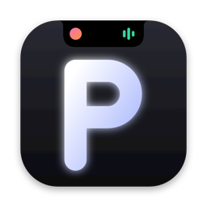
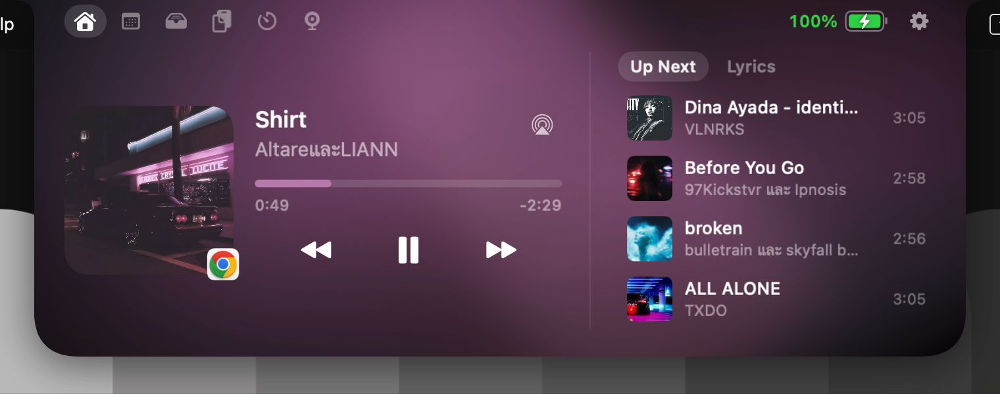
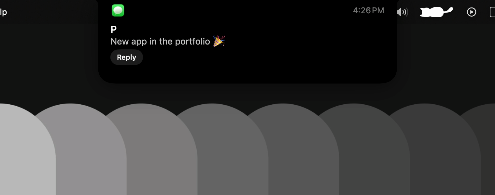

<div align="center">



# P Island

**A smart notch for your MacBook.**
Music, notifications, files, calendar and more — right where the notch is.


**English** · [ภาษาไทย](README.th.md)

[**⬇︎ Download P Island 1.4**](https://github.com/atikorn-sub/P-Island/raw/main/download/P-Island-1.4.zip)

</div>

---

## What it does

Move the pointer to the notch and it opens into a small panel. While it's closed, it quietly shows what's going on around the camera.

| | |
|---|---|
| 🎵 **Music** | Apple Music, Spotify and YouTube Music (Chrome). Cover, title, progress you can drag, play/pause/skip, and a soft ambient light in the cover's colours. **Up Next** (tap a song to play it) and **synced lyrics** that scroll with the song. Choose speakers, headphones or an AirPlay TV right from the player. Swipe sideways on the closed notch to skip. Optional slim bar across the menu bar that can show the line being sung. |
| 🔔 **Notifications** | Other apps' notifications drop down from the notch. Reply to iMessage without leaving what you're doing. Stays quiet while a Focus is on. |
| 📂 **Shelf** | Drag files to the notch and drop them on a zone: **keep on the shelf, AirDrop, zip, or shrink images** for chat. Pick several and drag them out together, copy them or their paths, or convert: images ↔ PNG/JPEG/HEIC/PDF, video → MP4/MOV/M4A, Word/RTF → PDF, speech → text. Real previews for pictures, PDFs and videos. Also *Open With › P Island* and `open -a "P Island" file`. |
| 📅 **Calendar & weather** | Month view, today's events, and a **Join** button a minute before Zoom, Meet, Teams, FaceTime or Webex meetings. Current weather and a 3-day forecast. |
| 📋 **Clipboard** | The last 40 things you copied, searchable. Kept in memory only; password managers are skipped. |
| ⏱ **Timers** | Several named timers at once (quick starts for coffee, noodles, laundry…), **Pomodoro** with automatic breaks, and a stopwatch with laps. A progress ring on the closed notch. |
| ✨ **Live Activities** | Download progress from Safari, Chrome and Firefox; a flash when an app starts using the camera or microphone; Caps Lock on/off. |
| 🪞 **Mirror** | Your front camera in the notch for a quick check before a call, with a ring light that brightens your face. |
| 🔋 **System** | Battery level in green / orange / red, low-battery and fully-charged alerts, time left on battery. Volume and brightness sliders in the notch. AirPods connecting, with battery per bud. |
| 🎨 **Make it yours** | Black or glass look (real Liquid Glass on macOS 26), four sizes, Thai or English, shortcuts <kbd>⌃⌥I</kbd> and <kbd>⌃⌥T</kbd>, swipe between tabs. Tells you when a new version is out. |

<!--
Screenshots: put PNGs in docs/screenshots/ and uncomment this block.

<p align="center">
   
   
</p>
-->

---

## Install

**You need:** macOS 14 Sonoma or later, on any Mac (Apple silicon or Intel). A notch is nice but not required.

1. **Download** [`P-Island-1.4.zip`](https://github.com/atikorn-sub/P-Island/raw/main/download/P-Island-1.4.zip).
2. **Double-click the `.zip`** to unzip it, then **drag P Island into Applications**.
3. **Open P Island** from Applications or Launchpad.
4. **The first time, macOS blocks it.** You'll see *"P Island" Not Opened — Apple could not verify "P Island" is free of malware…* This is expected, see [Why does macOS block it?](#why-does-macos-block-it) below. To allow it once:
   1. Click **Done** (not *Move to Trash*).
   2. Open **System Settings › Privacy & Security** and scroll to the bottom.
   3. Next to *"P Island" was blocked to protect your Mac*, click **Open Anyway**.
   4. Enter your password or use Touch ID, then click **Open Anyway** again.

   On **macOS 14 Sonoma** you can instead right-click P Island in Applications › **Open** › **Open**.

   <details><summary>Still says the app "is damaged"?</summary>

   That's the download quarantine flag. Remove it in Terminal, then open the app again:

   ```bash
   xattr -dr com.apple.quarantine "/Applications/P Island.app"
   ```
   </details>

5. A capsule icon appears in the menu bar, and the **Settings** window opens on **Permissions**. Everything below is optional — give only what you want to use.

### Why does macOS block it?

Every app downloaded from the internet is checked by **Gatekeeper**. To pass without a warning, an app has to be signed with a paid Apple Developer ID and *notarized* (scanned by Apple). P Island is a free, open-source portfolio project signed with a personal certificate instead, so macOS asks you to confirm once. Most free apps on GitHub show the same message.

You can read every line of the code in this repository, and P Island only goes online for weather, album covers, lyrics and an update check (see [Privacy](#privacy)). After you allow it once, it opens normally from then on.

### Permissions

| Permission | Used for | How |
|---|---|---|
| **Full Disk Access** | Other apps' notifications, replying to iMessage, knowing when Focus is on | Click *Open Settings*, drag P Island from the Finder window into the list, switch it on |
| **Calendar** | Events, month view, meeting Join button | Click *Allow* |
| **Bluetooth** | AirPods / device connect alerts | Click *Allow* |
| **Automation** (Music, Spotify, Messages) | Reading and controlling music, sending replies | Asked the first time each is used |
| **Speech Recognition** | Turning audio files into text | Asked the first time you transcribe |
| **Camera** | The Mirror tab | Asked the first time you open it |
| **Downloads folder** | Download progress (not needed with Full Disk Access) | Asked once at launch |
| **System Audio Recording** | Live waveform (off by default) | Asked when you switch it on |

The status of each one updates live in **Settings › Permissions**. Turn on **Launch at Login** in **Settings › General** to have it ready every time.

### YouTube Music (optional)

Apple Music and Spotify work straight away. For YouTube Music in Chrome, add the small companion extension:

1. Download [`P-Island-YouTube-Music-Extension.zip`](https://github.com/atikorn-sub/P-Island/raw/main/download/P-Island-YouTube-Music-Extension.zip) and unzip it.
2. In Chrome, go to `chrome://extensions` and switch on **Developer mode** (top right).
3. Click **Load unpacked** and choose the unzipped folder.
4. Reload your YouTube Music tab.

**Updating from P Island 1.3?** Download the extension again and replace the old folder, then click ↻ on its card in `chrome://extensions`. Version 1.4 adds Up Next and its covers.

The extension only runs on `music.youtube.com` and talks to P Island on your own Mac (`127.0.0.1`), nothing else.

---

## Using it

- **Open:** point at the notch, or press <kbd>⌃⌥I</kbd>. <kbd>⌃⌥T</kbd> jumps to the timer.
- **Tabs:** Home · Calendar & Weather · Shelf · Clipboard · Timers · Mirror — click the icons or swipe sideways with two fingers.
- **Songs:** swipe sideways with two fingers on the closed notch to skip. Up Next and Lyrics sit beside the player.
- **Files:** drag files up to the notch and drop them on a zone. Click files to select several; right-click for AirDrop, zip, shrink, convert and transcribe.
- **Settings:** the ⚙️ in the open notch, or the capsule icon in the menu bar › Settings… (<kbd>⌘,</kbd>)

## Privacy

Everything stays on your Mac.

- Notifications and messages are read **locally and read-only**; nothing is uploaded.
- The clipboard history lives **in memory only** and is gone when the app quits; items marked secret by password managers are skipped.
- The only internet requests are for **weather** ([Open-Meteo](https://open-meteo.com), with your chosen city's coordinates), **album covers** from the music services, **lyrics** ([LRCLIB](https://lrclib.net), with the song's title, artist and length; can be turned off) and a **daily update check** that reads one public file from this repository (can be turned off).
- The camera runs **only while the Mirror tab is open**; nothing is recorded. The Downloads folder is watched for **file names and sizes** only.
- The YouTube Music bridge listens on **127.0.0.1 only** and accepts connections from Chrome extensions only.

## Troubleshooting

| Problem | Fix |
|---|---|
| Notifications don't appear | Give **Full Disk Access** (Settings › Permissions), then quit and reopen P Island |
| Music isn't detected | Allow P Island to control Music / Spotify in System Settings › Privacy & Security › Automation |
| YouTube Music shows nothing | Check the extension is on, then reload the YouTube Music tab |
| No Up Next for YouTube Music | Update the extension to 1.4 (see [YouTube Music](#youtube-music-optional)) and reload the tab |
| The notch covers part of the menu bar | That's the *slim bar* style; switch to *Small wings* in Settings › General |

---

## Build from source

You only need Apple's Command Line Tools (no Xcode project):

```bash
xcode-select --install          # once
git clone https://github.com/atikorn-sub/P-Island.git
cd P-Island
./build.sh --install            # builds and installs to /Applications
./build.sh --release            # universal app .zip/.dmg and extension .zip in dist/
```

Builds are signed with a certificate named **P Island Developer** if your keychain has one (Keychain Access › Certificate Assistant › Create a Certificate…, type *Code Signing*). That keeps macOS permissions across rebuilds; without it the build is signed ad-hoc.

## How it works

<details><summary>For the curious</summary>

- **The notch** is a borderless `NSPanel` above the menu bar, sized from `NSScreen.safeAreaInsets` and `auxiliaryTopLeftArea/RightArea`. It ignores the mouse while closed so the menu bar stays clickable; hover is tracked with global event monitors. UI is SwiftUI with a custom notch `Shape` and spring animations.
- **Music:** Apple Music and Spotify through AppleScript plus their distributed notifications; YouTube Music through a Chrome extension that streams playback over a local WebSocket (`Network.framework`, loopback only, extension origins only).
- **Notifications:** read-only SQLite queries on macOS's Notification Center database; iMessage replies through Messages' AppleScript.
- **Focus:** watches macOS's Focus database folder with a `DispatchSource` and evaluates scheduled Focus modes.
- **Lyrics & updates:** LRCLIB's search API, matched by title, artist and length; a daily read of `download/latest.json`.
- **Live Activities:** the Downloads folder watched with a `DispatchSource` (Safari's `.download` bundles carry their total size), CoreMediaIO / CoreAudio "running somewhere" flags for camera and microphone, the modifier state for Caps Lock.
- **System:** CoreAudio for volume and a process tap for the live waveform, IOKit power sources, EventKit, IOBluetooth, Speech, PDFKit/AVFoundation converters, Carbon hot keys.
- **Glass:** SwiftUI `glassEffect` on macOS 26, and an `NSVisualEffectView` blur with highlight and rim on earlier versions.
- **Languages:** every string is Thai and English; dates follow the chosen language (Buddhist year in Thai).

```
Sources/           Swift app (≈ 8,300 lines, 43 files)
ChromeExtension/   YouTube Music companion (Manifest V3)
Resources/         Info.plist, icon, localised permission prompts
Design/            logo sources
build.sh           build, install and release script
```
</details>

## Credits

Developed by **Atikorn Subsuieng**.
Coding assistant: Claude (Anthropic). Weather data by [Open-Meteo.com](https://open-meteo.com) (CC BY 4.0). Lyrics from [LRCLIB](https://lrclib.net). Inspired by the iPhone's Dynamic Island.

## License

[MIT](LICENSE) © 2026 Atikorn Subsuieng
