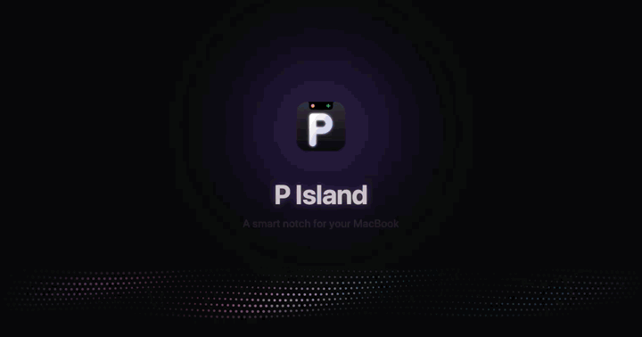
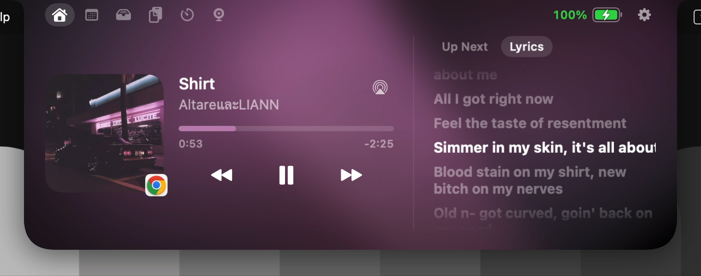
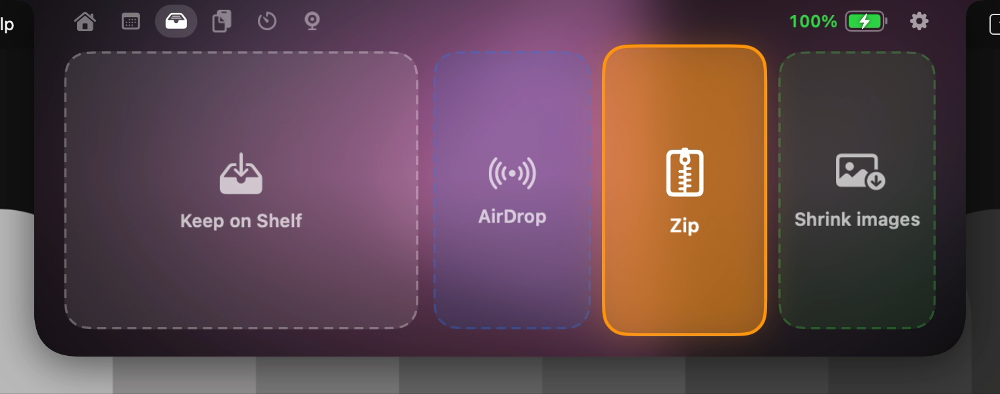
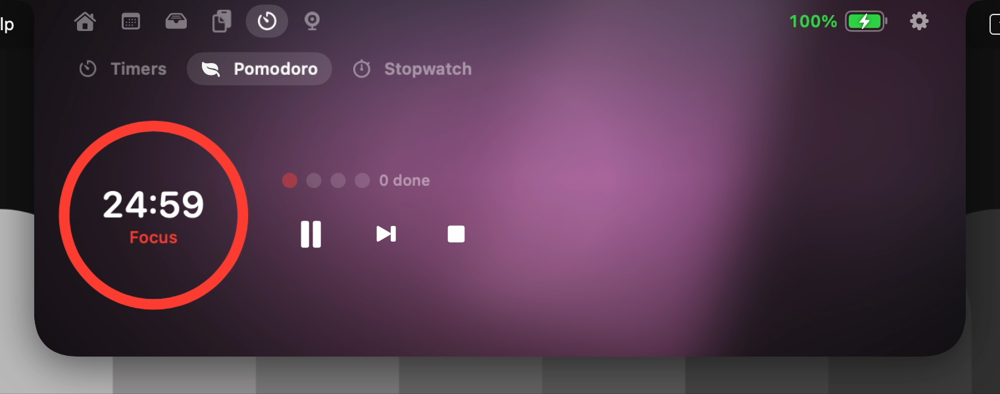
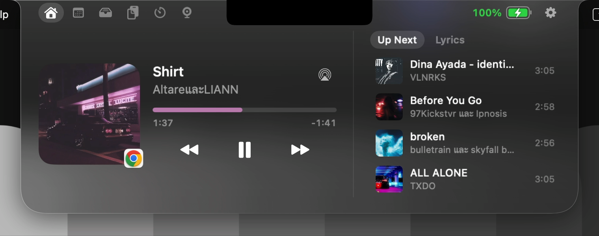

<div align="center">


# P Island

**รอยบากอัจฉริยะสำหรับ MacBook**
เพลง แจ้งเตือน ไฟล์ ปฏิทิน และอีกมากมาย อยู่ตรงรอยบากที่เดียว


[English](README.md) · **ภาษาไทย**

[**⬇︎ ดาวน์โหลด P Island 1.5**](https://github.com/atikorn-sub/P-Island/raw/main/download/P-Island-1.5.zip)

</div>

---

## ทำอะไรได้บ้าง

เลื่อนเมาส์ไปที่รอยบาก แผงเล็ก ๆ จะกางออกมา ตอนหดอยู่ก็คอยบอกเรื่องสำคัญรอบ ๆ กล้องแบบเงียบ ๆ

| | |
|---|---|
| 🎵 **เพลง** | Apple Music, Spotify และ YouTube Music (Chrome) มีปก ชื่อเพลง แถบเวลาที่ลากได้ ปุ่มเล่น/หยุด/ข้าม และแสงแอมเบียนต์สีเดียวกับปกเพลง มี**รายการถัดไป** (กดเพื่อเล่นเพลงนั้น) และ**เนื้อเพลงที่วิ่งตามเพลง** เลือกลำโพง หูฟัง หรือทีวี AirPlay ได้จากตัวเล่นเพลง ปัดซ้าย-ขวาบนรอยบากเพื่อข้ามเพลง และมีโหมดแถบยาวบนแถบเมนูที่โชว์ท่อนที่กำลังร้องได้ |
| 🔔 **แจ้งเตือน** | แจ้งเตือนจากแอปอื่นยืดลงมาจากรอยบาก ตอบ iMessage ได้โดยไม่ต้องสลับแอป และเงียบเองตอนเปิดโหมด Focus |
| 📂 **ชั้นวางไฟล์** | ลากไฟล์มาที่รอยบากแล้วปล่อยลงช่องที่ต้องการ: **เก็บบนชั้นวาง, AirDrop, บีบอัด zip หรือย่อรูป**ไว้ส่งแชต เลือกหลายไฟล์แล้วลากออกพร้อมกันได้ คัดลอกไฟล์หรือที่อยู่ไฟล์ หรือแปลงไฟล์ เช่น รูป ↔ PNG/JPEG/HEIC/PDF, วิดีโอ → MP4/MOV/M4A, Word/RTF → PDF และถอดเสียงเป็นข้อความ รูป PDF และวิดีโอมีภาพตัวอย่างจริง และเพิ่มไฟล์ผ่าน *Open With › P Island* หรือ `open -a "P Island" ไฟล์` ได้ |
| 📅 **ปฏิทิน เตือนความจำ และอากาศ** | ปฏิทินรายเดือน เลื่อนดูทีละวัน นัดหมายวันนี้ และปุ่ม **เข้าร่วม** ก่อนประชุม Zoom, Meet, Teams, FaceTime หรือ Webex ประมาณ 1 นาที มี **Reminders** ที่ติ๊กว่าทำเสร็จได้จากรอยบาก พร้อมสภาพอากาศและพยากรณ์ 3 วัน |
| 📋 **คลิปบอร์ด** | จำ 40 รายการล่าสุดที่คัดลอก ค้นหาได้ เก็บในหน่วยความจำเท่านั้น และข้ามรหัสผ่านจากแอปจัดการรหัสผ่าน |
| ⏱ **ตัวจับเวลา** | ตั้งได้หลายตัวพร้อมกันพร้อมชื่อ (มีปุ่มลัด ชงกาแฟ บะหมี่ ซักผ้า…) มี **Pomodoro** ที่สลับโฟกัสกับพักให้เอง และนาฬิกาจับเวลาพร้อมบันทึกรอบ มีวงแหวนเวลาบนรอยบาก |
| ✨ **Live Activity** | นับถอยหลัง 10 นาทีก่อนนัดถัดไป ความคืบหน้าการดาวน์โหลดจาก Safari, Chrome และ Firefox บอกตอนมีแอปเริ่มใช้กล้องหรือไมค์ และบอกตอนเปิด/ปิด Caps Lock |
| 🪞 **กระจก** | ใช้กล้องหน้าเป็นกระจกที่รอยบาก เช็กหน้าก่อนประชุม และมีไฟส่องหน้าแบบ ring light |
| 🔋 **ระบบ** | แบตเป็นสีเขียว/ส้ม/แดง เตือนแบตน้อยและชาร์จเต็ม บอกเวลาที่ใช้ได้ แถบปรับเสียงและความสว่างที่รอยบาก แจ้งตอน AirPods เชื่อมต่อพร้อม % แบตแต่ละข้าง |
| 🎨 **ปรับแต่งได้** | หน้าตาแบบดำหรือกระจก (บน macOS 26 เป็น Liquid Glass ของจริง) มี 4 ขนาด เลือกไทยหรืออังกฤษได้ ปุ่มลัด <kbd>⌃⌥I</kbd> และ <kbd>⌃⌥T</kbd> และปัดสลับแถบได้ และบอกเมื่อมีเวอร์ชันใหม่ |

<p align="center">
  
</p>
<p align="center">
   
   
</p>

---

## วิธีติดตั้ง

**ต้องมี:** macOS 14 Sonoma ขึ้นไป ใช้ได้กับ Mac ทุกรุ่น (ชิป Apple หรือ Intel) มีรอยบากจะสวยที่สุด แต่ไม่มีก็ใช้ได้

1. **ดาวน์โหลด** ไฟล์ [`P-Island-1.5.zip`](https://github.com/atikorn-sub/P-Island/raw/main/download/P-Island-1.5.zip)
2. **ดับเบิลคลิกไฟล์ `.zip`** เพื่อแตกไฟล์ แล้ว**ลาก P Island ไปไว้ใน Applications**
3. **เปิด P Island** จาก Applications หรือ Launchpad
4. **ครั้งแรก macOS จะบล็อกไว้** จะขึ้นหน้าต่าง *"P Island" Not Opened — Apple could not verify "P Island" is free of malware…* เป็นเรื่องปกติ (ดู[ทำไม macOS ถึงบล็อก](#ทำไม-macos-ถึงบล็อก) ด้านล่าง) วิธีอนุญาต ทำแค่ครั้งเดียว
   1. กด **Done** (อย่ากด *Move to Trash*)
   2. เปิด **System Settings › Privacy & Security** แล้วเลื่อนลงไปล่างสุด
   3. ตรงข้อความ *"P Island" was blocked to protect your Mac* กด **Open Anyway**
   4. ใส่รหัสผ่านหรือใช้ Touch ID แล้วกด **Open Anyway** อีกครั้ง

   ถ้าเป็น **macOS 14 Sonoma** คลิกขวาที่ P Island ใน Applications › **Open** › **Open** ได้เลย

   <details><summary>ยังขึ้นว่าแอป "is damaged" อยู่?</summary>

   เป็นเพราะ macOS ติดป้ายไฟล์ที่ดาวน์โหลดมาจากเน็ตไว้ ให้ลบป้ายนี้ใน Terminal แล้วเปิดแอปอีกครั้ง

   ```bash
   xattr -dr com.apple.quarantine "/Applications/P Island.app"
   ```
   </details>

5. จะมีไอคอนแคปซูลขึ้นบนแถบเมนู และหน้าต่าง**การตั้งค่า**จะเปิดที่หมวด**สิทธิ์การเข้าถึง** ทุกสิทธิ์ด้านล่างไม่บังคับ เลือกให้เฉพาะที่อยากใช้ก็พอ

### ทำไม macOS ถึงบล็อก

ทุกแอปที่ดาวน์โหลดจากอินเทอร์เน็ตจะถูก **Gatekeeper** ของ macOS ตรวจก่อน แอปที่จะเปิดได้โดยไม่มีคำเตือนต้องเซ็นด้วย Apple Developer ID แบบเสียเงิน และผ่านการตรวจ (notarize) จาก Apple ส่วน P Island เป็นผลงานฟรีแบบโอเพนซอร์สที่เซ็นด้วยใบรับรองส่วนตัว macOS เลยให้คุณยืนยันเองหนึ่งครั้ง แอปฟรีบน GitHub ส่วนใหญ่ก็ขึ้นข้อความแบบเดียวกัน

โค้ดทุกบรรทัดเปิดให้ดูได้ใน repo นี้ และ P Island ใช้อินเทอร์เน็ตแค่ดึงสภาพอากาศ ปกเพลง เนื้อเพลง และเช็กเวอร์ชันใหม่เท่านั้น (ดู[ความเป็นส่วนตัว](#ความเป็นส่วนตัว)) อนุญาตครั้งเดียวแล้วหลังจากนั้นจะเปิดได้ตามปกติ

### สิทธิ์ที่ใช้

| สิทธิ์ | ใช้ทำอะไร | วิธีให้ |
|---|---|---|
| **Full Disk Access** | แจ้งเตือนจากแอปอื่น ตอบ iMessage และรู้ว่าเปิดโหมด Focus อยู่ | กด *เปิดการตั้งค่า* แล้วลาก P Island จากหน้าต่าง Finder ลงในรายการ และเปิดสวิตช์ |
| **Calendar** | นัดหมาย ปฏิทินรายเดือน ปุ่มเข้าประชุม | กด *อนุญาต* |
| **Reminders** | รายการเตือนความจำวันนี้ และติ๊กว่าทำเสร็จ | กด *อนุญาต* |
| **Bluetooth** | แจ้งตอน AirPods และอุปกรณ์อื่นเชื่อมต่อ | กด *อนุญาต* |
| **Automation** (Music, Spotify, Messages) | อ่านและควบคุมเพลง ส่งข้อความตอบกลับ | macOS จะถามตอนใช้ครั้งแรก |
| **Speech Recognition** | ถอดเสียงจากไฟล์เป็นข้อความ | macOS จะถามตอนถอดเสียงครั้งแรก |
| **Camera** | แท็บกระจก | macOS จะถามตอนเปิดแท็บครั้งแรก |
| **โฟลเดอร์ Downloads** | ความคืบหน้าการดาวน์โหลด (ไม่ต้องให้ถ้าให้ Full Disk Access แล้ว) | macOS จะถามครั้งเดียวตอนเปิดแอป |
| **System Audio Recording** | คลื่นเสียงตามเพลงจริง (ปิดไว้เป็นค่าเริ่มต้น) | macOS จะถามตอนเปิดใช้ |

ดูสถานะของแต่ละสิทธิ์ได้ที่ **การตั้งค่า › สิทธิ์การเข้าถึง** สถานะจะอัปเดตเองทันที ถ้าอยากให้แอปเปิดเองทุกครั้งที่เข้าเครื่อง เปิด **เปิดตอนเข้าเครื่อง** ได้ที่ **การตั้งค่า › ทั่วไป**

### YouTube Music (ไม่บังคับ)

Apple Music กับ Spotify ใช้ได้ทันที ถ้าฟัง YouTube Music ใน Chrome ให้ติดตั้งส่วนขยายเล็ก ๆ เพิ่ม

1. ดาวน์โหลด [`P-Island-YouTube-Music-Extension.zip`](https://github.com/atikorn-sub/P-Island/raw/main/download/P-Island-YouTube-Music-Extension.zip) แล้วแตกไฟล์
2. ใน Chrome ไปที่ `chrome://extensions` แล้วเปิด **Developer mode** (มุมขวาบน)
3. กด **Load unpacked** แล้วเลือกโฟลเดอร์ที่แตกไฟล์ไว้
4. รีเฟรชแท็บ YouTube Music หนึ่งครั้ง

**อัปเดตจาก P Island 1.3?** ดาวน์โหลดส่วนขยายใหม่แล้วแทนที่โฟลเดอร์เดิม จากนั้นกด ↻ ที่การ์ดของส่วนขยายใน `chrome://extensions` เวอร์ชัน 1.4 เพิ่มรายการถัดไปและปกเพลงของรายการ

ส่วนขยายนี้ทำงานเฉพาะในหน้า `music.youtube.com` และคุยกับ P Island ในเครื่องคุณเองเท่านั้น (`127.0.0.1`)

---

## วิธีใช้

- **เปิดรอยบาก:** ชี้เมาส์ที่รอยบาก หรือกด <kbd>⌃⌥I</kbd> ส่วน <kbd>⌃⌥T</kbd> ไปที่ตัวจับเวลาเลย
- **แถบต่าง ๆ:** หน้าหลัก · ปฏิทินและสภาพอากาศ · ชั้นวางไฟล์ · คลิปบอร์ด · ตัวจับเวลา · กระจก คลิกที่ไอคอน หรือปัดซ้าย-ขวาสองนิ้วบนแทร็กแพด
- **เพลง:** ปัดซ้าย-ขวาสองนิ้วบนรอยบากตอนปิดอยู่เพื่อข้ามเพลง รายการถัดไปกับเนื้อเพลงอยู่ข้างตัวเล่นเพลง
- **ไฟล์:** ลากไฟล์ขึ้นไปที่รอยบากแล้วปล่อยลงช่องที่ต้องการ คลิกไฟล์เพื่อเลือกหลายไฟล์ คลิกขวาเพื่อส่ง AirDrop บีบอัด zip ย่อรูป แปลงไฟล์ หรือถอดเสียง
- **การตั้งค่า:** กด ⚙️ ในรอยบากที่กางอยู่ หรือไอคอนแคปซูลบนแถบเมนู › การตั้งค่า… (<kbd>⌘,</kbd>)

## ความเป็นส่วนตัว

ข้อมูลทุกอย่างอยู่ในเครื่องคุณ

- แจ้งเตือนและข้อความ**อ่านในเครื่องแบบอ่านอย่างเดียว** ไม่มีการอัปโหลดไปที่ไหน
- ประวัติคลิปบอร์ดเก็บ**ในหน่วยความจำเท่านั้น** หายเมื่อปิดแอป และข้ามข้อมูลที่แอปจัดการรหัสผ่านติดป้ายว่าเป็นความลับ
- ใช้อินเทอร์เน็ตแค่ดึง**สภาพอากาศ** ([Open-Meteo](https://open-meteo.com) ส่งไปแค่พิกัดเมืองที่เลือก) **ปกเพลง**จากบริการเพลง **เนื้อเพลง** ([LRCLIB](https://lrclib.net) ส่งไปแค่ชื่อเพลง ศิลปิน และความยาวเพลง ปิดได้) และ**เช็กเวอร์ชันใหม่วันละครั้ง** โดยอ่านไฟล์สาธารณะไฟล์เดียวใน repo นี้ (ปิดได้)
- กล้องทำงาน**เฉพาะตอนเปิดแท็บกระจก** ไม่มีการบันทึกภาพ ส่วนโฟลเดอร์ Downloads ดูแค่**ชื่อและขนาดไฟล์**
- ตัวเชื่อม YouTube Music รับการเชื่อมต่อแค่ใน**เครื่องตัวเอง (127.0.0.1)** และเฉพาะจาก Chrome extension เท่านั้น

## แก้ปัญหาเบื้องต้น

| ปัญหา | วิธีแก้ |
|---|---|
| แจ้งเตือนไม่ขึ้น | ให้สิทธิ์ **Full Disk Access** (การตั้งค่า › สิทธิ์การเข้าถึง) แล้วปิดและเปิด P Island ใหม่ |
| ไม่เจอเพลงที่เล่น | อนุญาตให้ P Island ควบคุม Music / Spotify ที่ System Settings › Privacy & Security › Automation |
| YouTube Music ไม่ขึ้น | เช็กว่าเปิดส่วนขยายอยู่ แล้วรีเฟรชแท็บ YouTube Music |
| YouTube Music ไม่มีรายการถัดไป | อัปเดตส่วนขยายเป็น 1.4 (ดูหัวข้อ YouTube Music ด้านบน) แล้วรีเฟรชแท็บ |
| รอยบากบังแถบเมนูบางส่วน | นั่นคือโหมด*แถบยาว* เปลี่ยนเป็น*ปีกเล็ก*ได้ที่ การตั้งค่า › ทั่วไป |

---

## Build เองจากซอร์สโค้ด

ใช้แค่ Command Line Tools ของ Apple ไม่ต้องมีโปรเจกต์ Xcode

```bash
xcode-select --install          # ทำครั้งเดียว
git clone https://github.com/atikorn-sub/P-Island.git
cd P-Island
./build.sh --install            # build แล้วติดตั้งลง /Applications
./build.sh --release            # ได้แอปแบบ universal เป็น .zip/.dmg และ .zip ของส่วนขยายใน dist/
```

ถ้าใน Keychain มีใบรับรองชื่อ **P Island Developer** ตัว build จะเซ็นแอปด้วยใบรับรองนั้น (สร้างได้ที่ Keychain Access › Certificate Assistant › Create a Certificate… เลือกประเภท *Code Signing*) จะทำให้สิทธิ์ของ macOS ไม่หายเวลา build ใหม่ ถ้าไม่มี จะเซ็นแบบ ad-hoc แทน

## เบื้องหลังการทำงาน

<details><summary>สำหรับคนที่สนใจ</summary>

- **ตัวรอยบาก** เป็น `NSPanel` แบบไม่มีขอบที่อยู่เหนือแถบเมนู คำนวณขนาดจาก `NSScreen.safeAreaInsets` และ `auxiliaryTopLeftArea/RightArea` ตอนหดจะไม่รับเมาส์ แถบเมนูเลยยังกดได้ตามปกติ และใช้ global event monitor ตรวจว่าเมาส์ชี้อยู่ไหม หน้าจอทำด้วย SwiftUI ใช้ `Shape` รูปรอยบากที่วาดเอง และแอนิเมชันแบบสปริง
- **เพลง:** Apple Music กับ Spotify ผ่าน AppleScript และ distributed notification ส่วน YouTube Music ผ่าน Chrome extension ที่ส่งสถานะเพลงผ่าน WebSocket ในเครื่อง (`Network.framework` รับเฉพาะ loopback และเฉพาะ origin ของ extension)
- **แจ้งเตือน:** อ่านฐานข้อมูล SQLite ของ Notification Center แบบอ่านอย่างเดียว และตอบ iMessage ผ่าน AppleScript ของแอป Messages
- **Focus:** เฝ้าโฟลเดอร์ฐานข้อมูล Focus ของ macOS ด้วย `DispatchSource` และคำนวณโหมด Focus ที่ตั้งเวลาไว้เอง
- **เนื้อเพลงและอัปเดต:** ใช้ API ค้นหาของ LRCLIB จับคู่ด้วยชื่อเพลง ศิลปิน และความยาวเพลง และอ่านไฟล์ `download/latest.json` วันละครั้ง
- **Live Activity:** เฝ้าโฟลเดอร์ Downloads ด้วย `DispatchSource` (ไฟล์ `.download` ของ Safari บอกขนาดทั้งหมดไว้) ใช้ค่า "running somewhere" ของ CoreMediaIO / CoreAudio สำหรับกล้องและไมค์ และอ่านสถานะปุ่ม modifier สำหรับ Caps Lock
- **ระบบ:** CoreAudio สำหรับระดับเสียง และ process tap สำหรับคลื่นเสียงจริง, IOKit สำหรับแบตเตอรี่, EventKit, IOBluetooth, Speech, ตัวแปลงไฟล์ด้วย PDFKit/AVFoundation และปุ่มลัดด้วย Carbon
- **กระจก:** ใช้ `glassEffect` ของ SwiftUI บน macOS 26 ส่วนเวอร์ชันก่อนหน้าใช้การเบลอของ `NSVisualEffectView` พร้อมแสงสะท้อนและเส้นขอบ
- **ภาษา:** ทุกข้อความมีทั้งไทยและอังกฤษ วันที่เปลี่ยนตามภาษาที่เลือก (ภาษาไทยใช้ปี พ.ศ.)

```
Sources/           โค้ดแอป Swift (ประมาณ 8,600 บรรทัด 43 ไฟล์)
ChromeExtension/   ส่วนขยายสำหรับ YouTube Music (Manifest V3)
Resources/         Info.plist, ไอคอน, ข้อความขอสิทธิ์สองภาษา
Design/            ไฟล์ต้นฉบับโลโก้
build.sh           สคริปต์ build ติดตั้ง และทำไฟล์สำหรับแจก
```
</details>

## เครดิต

พัฒนาโดย **Atikorn Subsuieng**
ผู้ช่วยเขียนโค้ด: Claude (Anthropic) · ข้อมูลสภาพอากาศจาก [Open-Meteo.com](https://open-meteo.com) (CC BY 4.0) · เนื้อเพลงจาก [LRCLIB](https://lrclib.net) · ได้แรงบันดาลใจจาก Dynamic Island ของ iPhone

## สัญญาอนุญาต

[MIT](LICENSE) © 2026 Atikorn Subsuieng
